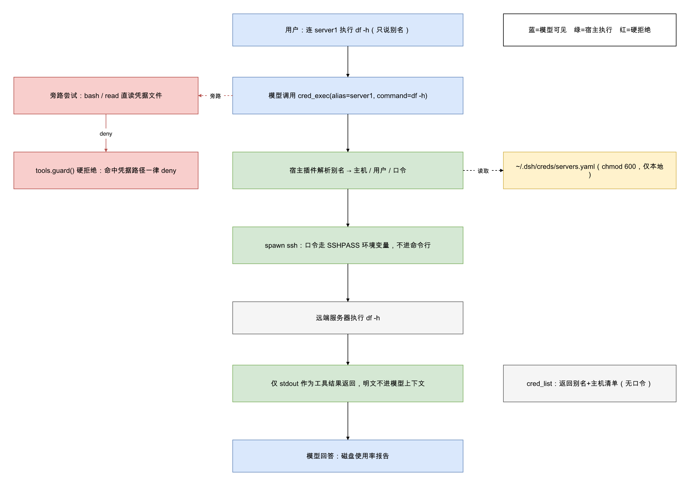
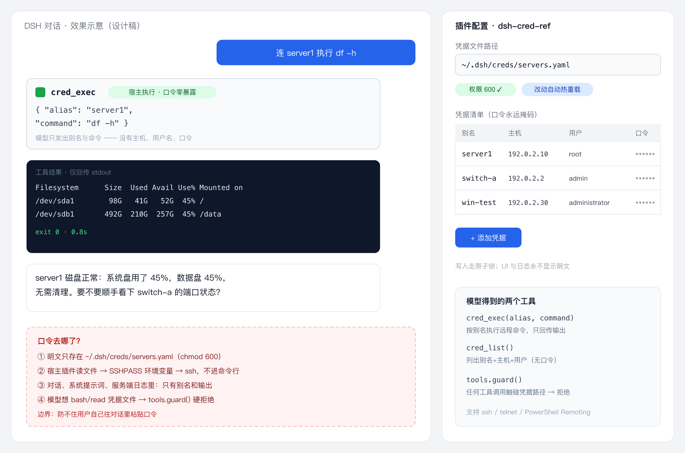

# dsh-cred-ref

DeepSeek Harness 凭据引用插件：对话里只说**别名**，宿主进程解析本地凭据并远程执行（ssh / telnet），明文口令永不进入对话、系统提示词或服务端日志。附带插件配置页的凭据管理 UI（添加/编辑/删除，口令永远掩码）。

## 效果预览

机制流程（含 guard 硬拒绝分支）：



最终效果示意（对话 + 配置页，设计稿）：



可交互 HTML 版（浏览器直接打开）：[docs/preview.html](docs/preview.html)；矢量源：[docs/images/mockup.svg](docs/images/mockup.svg)。

## 能力

- `cred_exec(alias, command)`：按别名远程执行，只回传 stdout/stderr/退出码/耗时
- `cred_list()`：别名/主机/端口/用户/类型（无口令）
- 配置页面板：凭据清单 + 添加/编辑/删除表单（原子写、chmod 600、保留头部注释）
- 可选侧边栏面板（v1.1+）：配置页开关开启后，侧边栏「凭据管理」行直达同一面板；开关状态持久化
- `tools.guard()` 硬拒绝：任何其它工具调用触碰凭据路径 → deny（读与写都拦）

## 安装

```bash
git clone https://github.com/Moxb-2020/dsh-cred-ref.git
```

DSH 内：`plugin_manager install_bundle <克隆目录>`，或 Plugins → Add plugin 选该目录。依赖 `sshpass`（SSH 密码认证）：`brew install esolitos/ipa/sshpass`。

## 凭据库

默认 `~/.dsh/creds/servers.yaml`（配置项 `credsPath` 可改），权限必须 600：

```yaml
server-a:
  host: 192.0.2.10
  port: 22
  user: root
  password: "你的口令"
  kind: ssh          # ssh（默认）或 telnet

switch-a:
  host: 192.0.2.2
  port: 23
  user: admin
  password: "登录口令"
  enable: "特权口令"  # telnet 可选
  kind: telnet
```

也可完全在插件配置页 UI 里维护，无需手改文件。

## 安全边界（诚实声明）

- 防不住用户自己往对话里粘贴口令
- guard 挡的是工具调用通道，不是操作系统级访问控制（同 UID 进程仍可绕）
- telnet 交互按 Cisco IOS 提示符匹配，其它厂商需调整
- Windows PowerShell Remoting（pwsh）暂未实现

## 配套技能

[dsh-ssh-toolkit](https://github.com/Moxb-2020/dsh-ssh-toolkit)：测试环境远程管理流程（连通性闸口、离线甄别、设备分流），模型侧主路径即本插件。

## 测试

```bash
node test-crud.mjs   # CRUD/RPC 形状单元测试（临时文件，不碰真凭据库）
```

## License

MIT
